# AI-Works

只是个 AI 作品集展示 👀

- [视频1：暗黑奇幻动作短片](#视频1暗黑奇幻动作短片)
- [AI 视频（Sora 2）](#ai-视频sora-2)
- [视频2：小短剧（制作中）](#视频2小短剧制作中)
- [AI 图片](#ai-图片)

---

## 视频1：暗黑奇幻动作短片

▶ [完整视频.mp4](视频1/完整视频.mp4)　｜　📄 [全流程提示词.docx](视频1/全流程提示词.docx)

一段银发女猎手和暗甲领主的打斗短片，暗黑奇幻、半写实游戏 CG 风格。

- **设定图 / 分镜图**：ChatGPT、即梦
- **图生视频**：Google Flow（Omni 1.2 Flash），用首尾帧做镜头之间的转场
- **剪辑**：剪映
- **成片**：16:9，1080P

做的时候主要在琢磨这几件事：
- 先把角色设定图定下来，尽量让每个镜头里的人物长得一致
- 用首尾帧把镜头串起来，尽量做出一镜到底的感觉
- 两句英文台词（*"Is that all?"* / *"Glacial Lance!"*）做了对口型
- 特写镜头用 360p 抽卡再超分到 1080p，大场面直接出 720p

### 设定图

| 主角 | Boss | 场景 |
|---|---|---|
| 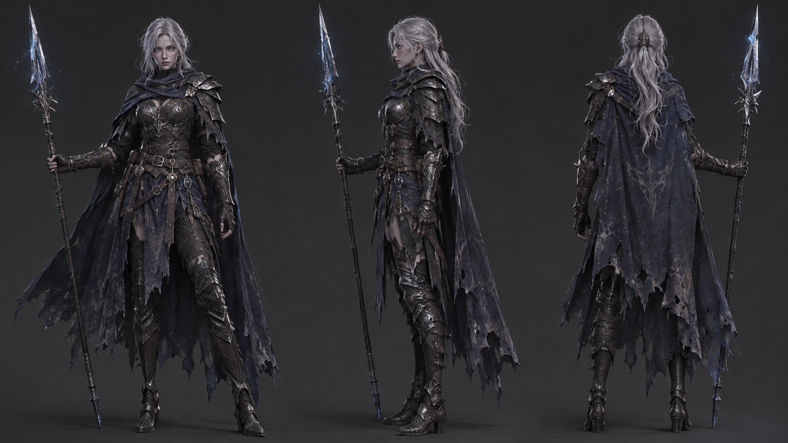 | 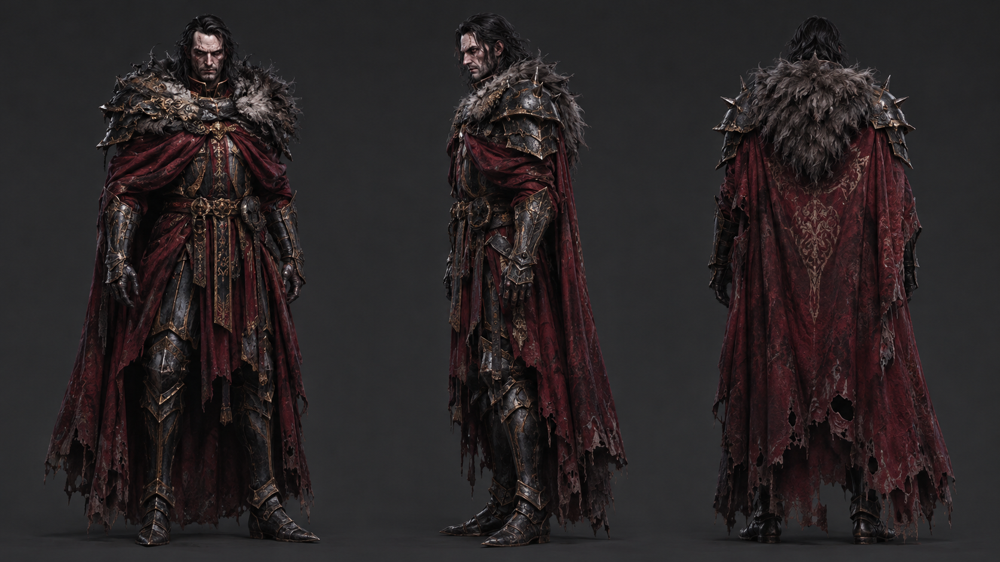 | 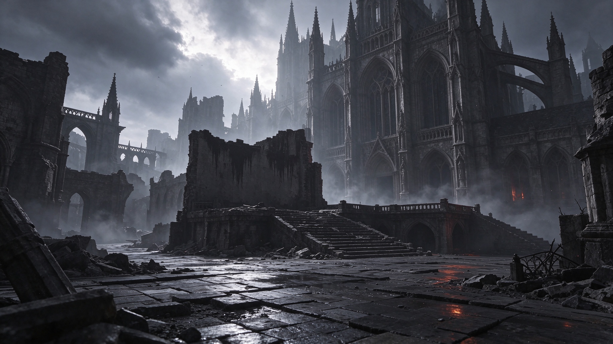 |

### 分镜图

| L1 | L2 | L3 |
|---|---|---|
| 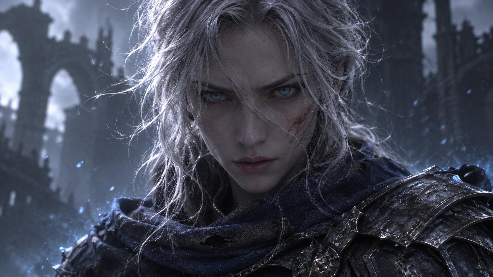 | 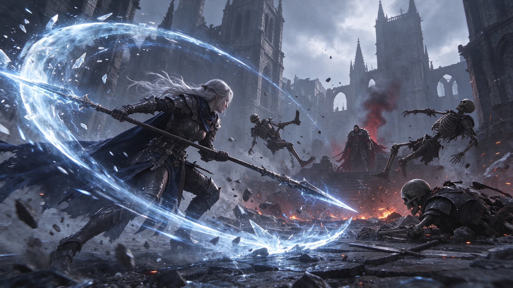 |  |
| **L4** | **L5** | **L6** |
| 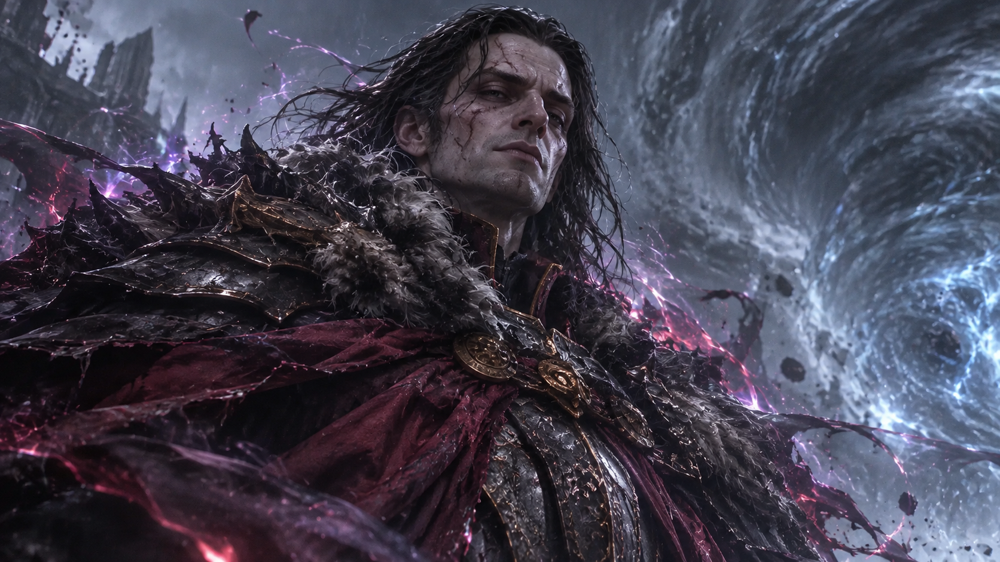 | 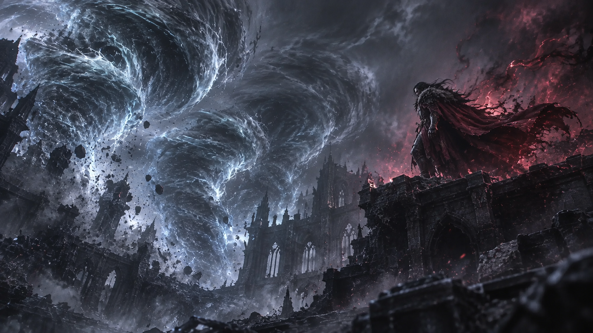 | 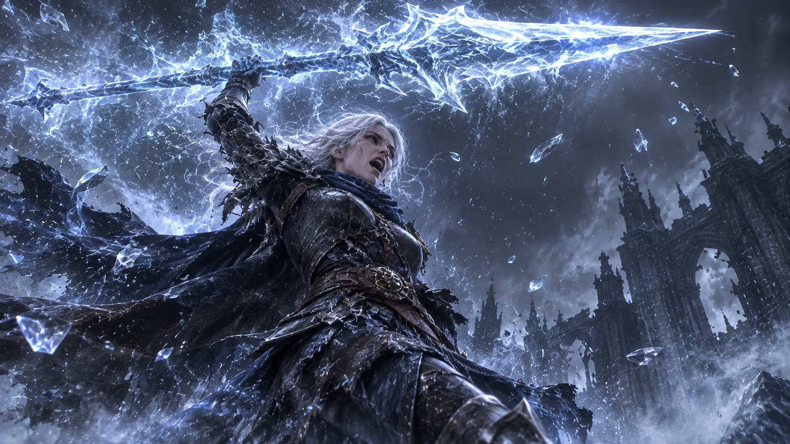 |
| **L7** | **L8 首帧** | **L8 尾帧** |
| 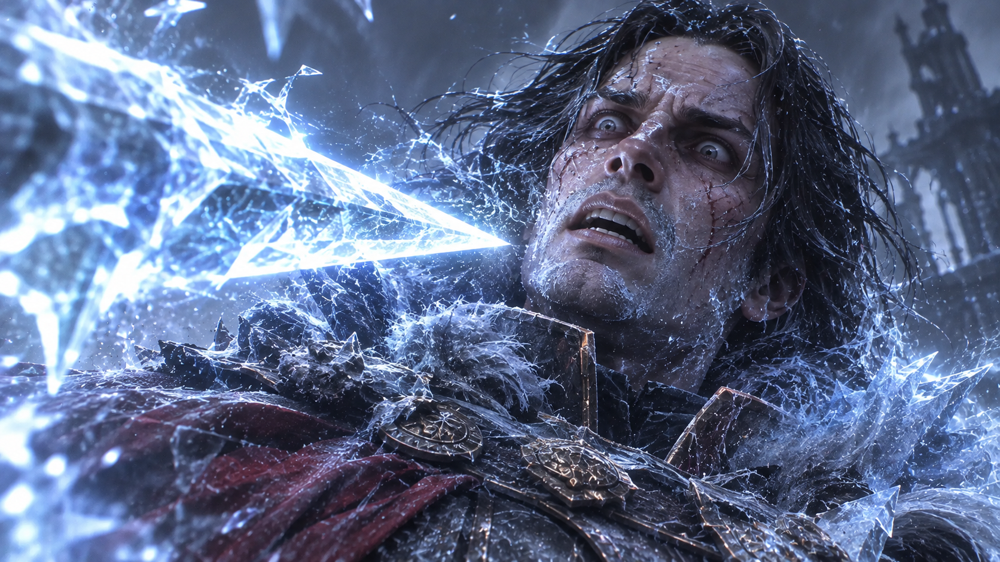 | 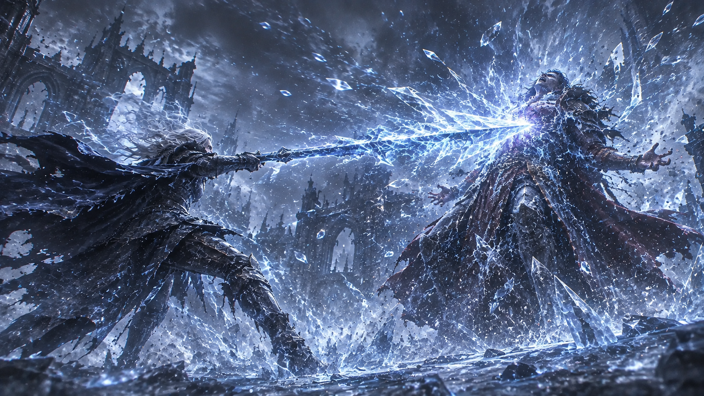 | 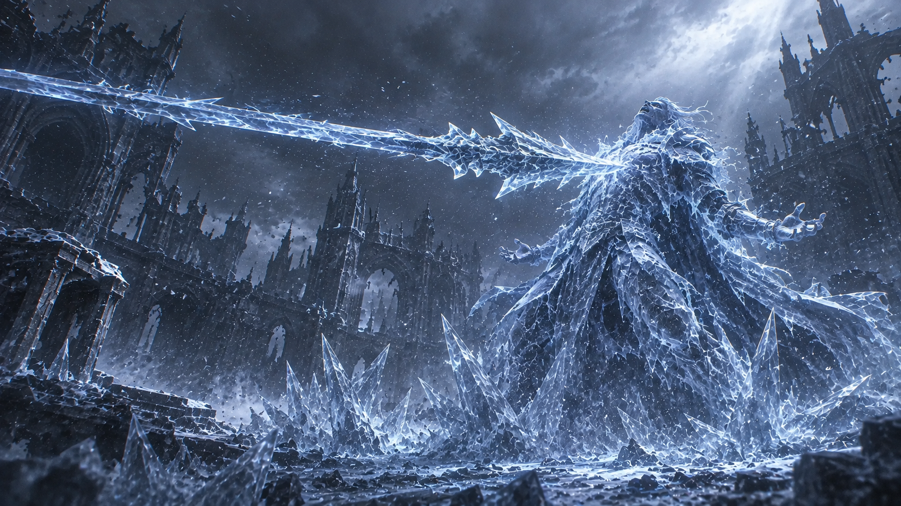 |

过程素材：[分镜视频](视频1/分镜视频)（14 段）、[过渡图](视频1/过渡图)（12 张）

---

## AI 视频（Sora 2）

都是之前用 Sora 2 直出的，没有做后期。

- ▶ [中世纪](AI视频/中世纪.mp4)
- ▶ [多场景](AI视频/多场景.mp4)
- ▶ [废墟](AI视频/废墟.mp4)
- ▶ [恋爱](AI视频/恋爱.mp4)
- ▶ [科幻](AI视频/科幻.mp4)
- ▶ [荒野牛仔](AI视频/荒野牛仔.mp4)
- ▶ [赛博朋克](AI视频/赛博朋克.mp4)
- ▶ [赛博朋克 2](AI视频/赛博朋克2.mp4)

---

## 视频2：小短剧（制作中）

打算做成一部小短剧，还在慢慢搞，目前只有角色设定图。

| 女主 | 男主 | 反派 |
|---|---|---|
| 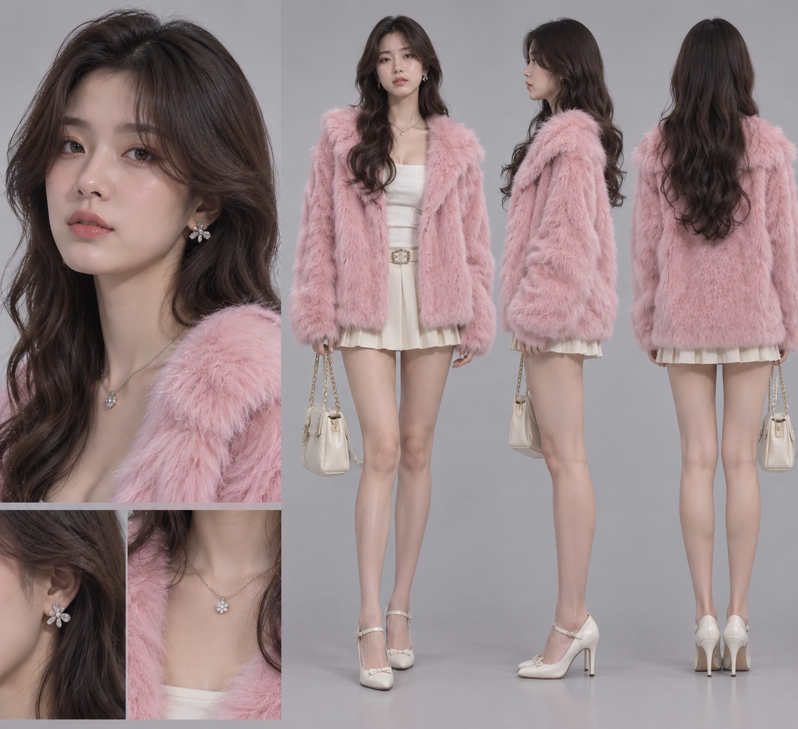 | 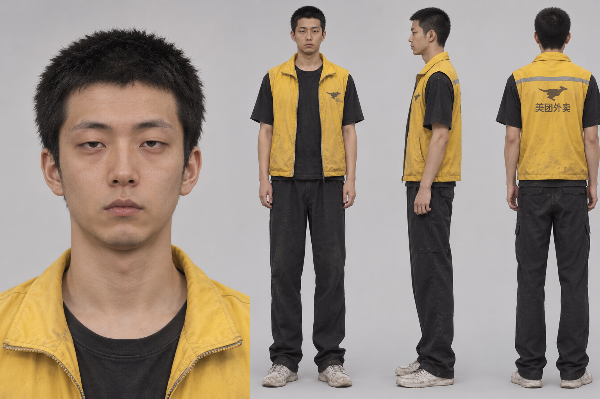 | 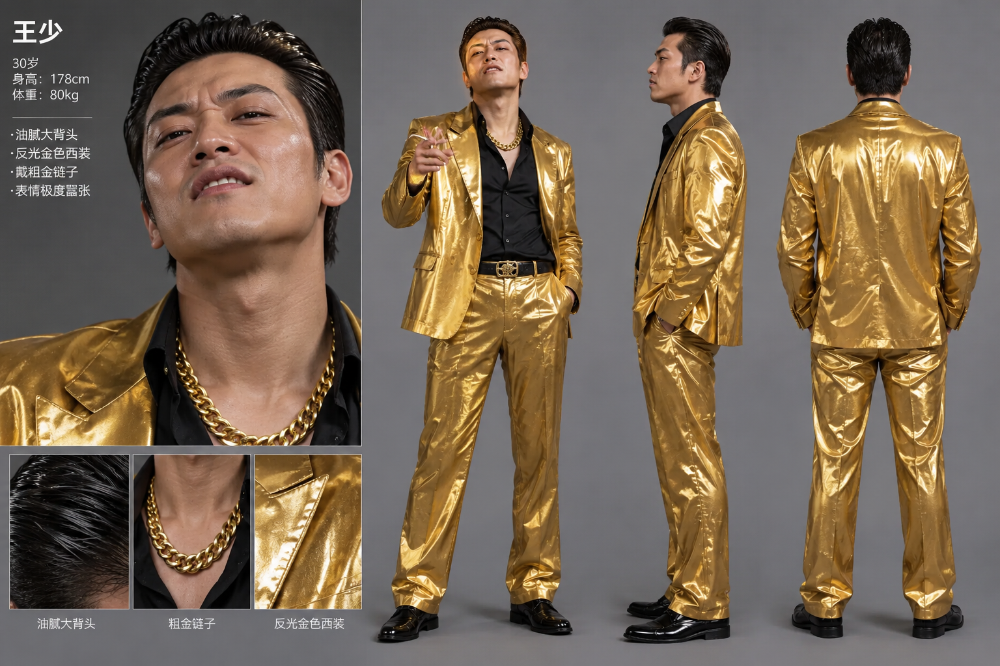 |

---

## AI 图片

📄 [AI图片.pdf](AI图片.pdf)（23 页）

用 ComfyUI + Illustrious 系列模型生成，有 Q 版二次元、国风人物、奇幻场景、城市夜景等风格。
